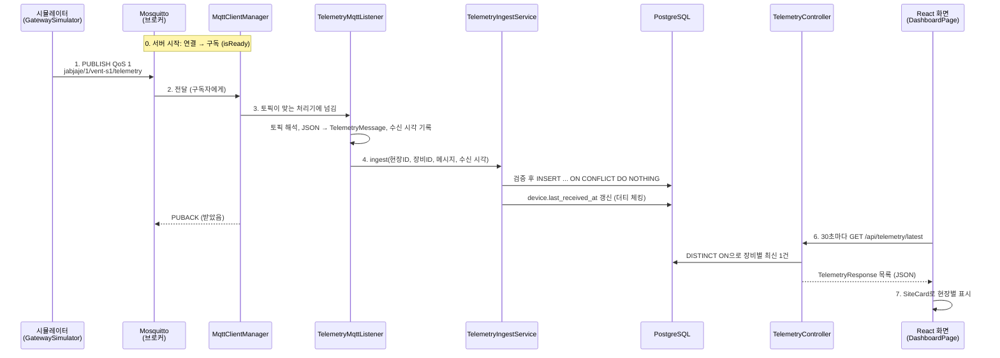

# 코드 따라가기: 측정값 하나의 여정

2026-10-23까지 만든 코드(#1, #2)를 **측정값 하나가 시뮬레이터에서 화면까지 가는 순서**로 따라간다.
단계마다 "어떤 파일이 무엇을 하는지", "현업에서 부르는 이름", "면접에서 나올 질문"을 붙였다.
용어 뜻은 [industry-terms.md](industry-terms.md)에 모아 두었다.

---

## 전체 흐름

---

## 0. 서버가 뜰 때: 브로커 연결과 구독

| 파일 | 하는 일 |
|---|---|
| `server/.../VentMonitoringApplication.java` | 앱 시작. `@ConfigurationPropertiesScan`으로 `vent.mqtt.*` 설정을 읽는다 |
| `server/.../global/mqtt/MqttBrokerProperties.java` | 브로커 주소, 클라이언트 ID 설정 값 |
| `server/.../global/mqtt/MqttClientManager.java` | 앱이 뜰 때 브로커에 연결하고(`start()`), 연결되면 모든 처리기의 토픽을 구독한다(`connectComplete()` → `subscribeAll()`) |
| `server/.../global/mqtt/MqttMessageHandler.java` | "이 토픽은 내가 처리한다"를 나타내는 인터페이스. 기능마다 구현체를 빈으로 둔다 |

**흐름**
1. Spring이 `SmartLifecycle.start()`를 부른다.
2. 브로커가 아직 없을 수 있어서, 연결은 **별도 스레드에서 1초 → 2초 → 4초… 최대 30초 간격으로 재시도**한다.
3. 연결되면 `jabjaje/+/+/telemetry`를 QoS 1로 구독하고 `isReady()`가 true가 된다.
4. **세션 유지(clean start = false)**: 서버가 재시작되는 동안 온 메시지는 브로커가 보관했다가 넘겨준다.

**현업 용어**: 라이프사이클 빈, 지수 백오프, 영속 세션, 구독, 준비 상태(readiness)

**면접 질문**
- "브로커가 서버보다 늦게 뜨면요?" → 서버는 먼저 뜨고, 연결은 백그라운드에서 간격을 늘려 가며 재시도한다.
- "서버 재시작 중 메시지는요?" → 세션을 유지하고 QoS 1로 구독해서 브로커가 보관한다.

---

## 1. 시뮬레이터: 측정값을 만들어 보낸다

| 파일 | 하는 일 |
|---|---|
| `simulator/.../SimulatorApplication.java` | 현장 3곳마다 게이트웨이 시뮬레이터를 만들고, 30초마다 발행하도록 예약한다 |
| `simulator/.../SiteConfig.java` | 현장 하나의 설정(현장 ID, 게이트웨이 ID, 환기장치 ID, 목표 풍량) |
| `simulator/.../GatewaySimulator.java` | 현장 게이트웨이 하나. 브로커에 연결하고 측정값을 JSON으로 바꿔 발행한다 |
| `simulator/.../TelemetryGenerator.java` | 이전 값에서 조금씩 움직이는(랜덤 워크) 그럴듯한 측정값을 만든다 |
| `simulator/.../TelemetryMessage.java` | 메시지 형식. `schemaVersion`을 포함한다 |

**흐름**
1. `ScheduledExecutorService`가 30초마다 `publishTelemetry()`를 부른다.
2. 측정값을 만들고 Jackson으로 JSON 바이트로 바꾼다(**직렬화**).
3. `jabjaje/{현장ID}/{장비ID}/telemetry`에 **QoS 1**로 발행한다.

**왜 이렇게?**
- 실제 게이트웨이는 환기장치를 Modbus로 읽어 MQTT로 바꿔 보낸다(**프로토콜 변환**). 시뮬레이터는 그 바깥쪽만 흉내 낸다.
- 측정 시각은 서울 시간(+09:00)으로 보낸다. 서버는 UTC로 저장한다.
- `Random` 시드가 1, 2, 3처럼 가까우면 값이 거의 같아서, 시드를 섞었다.

**현업 용어**: 스케줄러, 직렬화, 토픽, QoS, 프로토콜 변환, 메시지 스키마 버전

---

## 2. 브로커: Mosquitto가 전달한다

| 파일 | 하는 일 |
|---|---|
| `infra/mosquitto/mosquitto.conf` | 1883 포트, 익명 허용(#13에서 계정·ACL), 세션·retained 저장(persistence) |
| `docker-compose.yml` | `mosquitto` 서비스 |

**흐름**: 보낸 쪽(게이트웨이)과 받는 쪽(서버)은 서로를 모른다. 둘 다 브로커만 안다(**발행/구독**). QoS 1이라 서버가 **PUBACK**을 보낼 때까지 브로커가 책임지고 보낸다.

**면접 질문**: "QoS 1이면 중복이 오지 않나요?" → 올 수 있다. 그래서 4단계에서 messageId로 걸러낸다.

---

## 3. 서버 입구: 메시지를 받아 해석한다

| 파일 | 하는 일 |
|---|---|
| `MqttClientManager.messageArrived()` | 받은 토픽에 맞는 처리기를 찾아 넘긴다. **처리기 예외를 모두 잡는다** (예외가 Paho까지 가면 연결이 끊김) |
| `server/.../telemetry/listener/TelemetryMqttListener.java` | 토픽을 `/`로 나눠 현장 ID, 장비 ID를 읽고, JSON을 `TelemetryMessage`로 바꾼다(**역직렬화**). 서버 수신 시각을 이 순간 기록한다 |
| `server/.../telemetry/dto/request/TelemetryMessage.java` | 들어오는 메시지 형식. **모르는 필드는 무시**한다(ADR-0004) |

**왜 listener 레이어인가?** HTTP 요청을 받는 `controller`와 같은 "입구" 역할이지만, 메시지 입구라서 따로 둔다(ADR-0008). 현업에서는 Kafka나 MQTT 입구를 `listener`, `consumer`라고 부른다.

**현업 용어**: 인바운드 어댑터, 역직렬화, 관대한 수신(tolerant reader), 토픽 필터

---

## 4. 검증하고 저장한다

| 파일 | 하는 일 |
|---|---|
| `server/.../telemetry/service/TelemetryIngestService.java` | 수신 유스케이스. 하나의 **트랜잭션** 안에서 검증 → 저장 → 장비 마지막 수신 시각 갱신 |
| `server/.../telemetry/service/TelemetryIngestResult.java` | 처리 결과(STORED, DUPLICATE, DEVICE_ID_MISMATCH, SITE_MISMATCH, UNKNOWN_DEVICE, INVALID) |
| `server/.../site/repository/DeviceRepository.java` | 장비 조회 (JPA) |
| `server/.../site/domain/Device.java` | `belongsTo(현장ID)`, `markReceived(수신 시각)` |
| `server/.../telemetry/repository/TelemetryRepository.java` | 측정값 저장소 (JPA + 아래 직접 SQL 조각) |
| `server/.../telemetry/repository/TelemetryInsertRepository(Impl).java` | `INSERT ... ON CONFLICT (message_id) DO NOTHING` (JdbcClient) |
| `server/.../telemetry/repository/TelemetryInsertParams.java` | INSERT 파라미터 묶음 |

**검증 순서**
1. 필수 값이 다 있나 → 없으면 INVALID
2. 토픽의 장비 ID = 메시지의 장비 ID인가 → 다르면 DEVICE_ID_MISMATCH (**위조 방지**: 브로커 ACL은 토픽 단위로 권한을 주니까 토픽을 믿는다)
3. 등록된 장비인가 → 아니면 UNKNOWN_DEVICE
4. 토픽의 현장이 장비의 현장인가 → 아니면 SITE_MISMATCH
5. 저장. 영향받은 행이 0이면 이미 있던 messageId → DUPLICATE
6. `device.markReceived()`: 필드만 바꾸면 트랜잭션이 끝날 때 JPA가 UPDATE를 보낸다(**더티 체킹**)

**왜 JPA가 아니라 직접 SQL로 저장?** JPA에는 "충돌이면 무시"가 없다. PostgreSQL 기능을 쓰려고 이 한 곳만 JdbcClient로 직접 SQL을 썼다. Spring Data의 **사용자 정의 조각**이라 `TelemetryRepository` 하나로 둘 다 쓸 수 있고, 구현 클래스 이름은 반드시 `...Impl`로 끝나야 한다.

**알려진 빈틈 (#3에서 해결)**: 저장 중 DB 오류가 나도 PUBACK이 나가서 측정값이 사라진다 → 수동 확인 응답(manual ack). 스펙 9.1 C15.

**현업 용어**: 유스케이스, 트랜잭션 경계, 멱등성, 중복 제거, 더티 체킹, 영속성 컨텍스트, 커스텀 리포지토리

**면접 질문**
- "같은 메시지가 두 번 오면요?" → messageId 유니크 제약 + `ON CONFLICT DO NOTHING`. 최소 한 번 전달 + 멱등 저장.
- "다른 현장 장비인 척 보내면요?" → 장비 ID는 토픽에서 읽고, 메시지 값·현장과 다르면 거절.

---

## 5. 데이터베이스

| 파일 | 하는 일 |
|---|---|
| `db/migration/V1__site_gateway_device.sql` | 현장, 게이트웨이, 장비. 장비와 게이트웨이의 현장이 같도록 **복합 외래키** |
| `db/migration/V3__telemetry.sql` | 측정값 테이블. `message_id` 유니크, `(device_id, measured_at DESC)` 인덱스, `device.last_received_at` |
| `db/seed/R__demo_seed.sql` | 시연용 현장 3곳. **demo 프로필에서만** (ADR-0011) |
| `application.yml` | Flyway는 스키마만, Hibernate는 검증만(`ddl-auto: validate`), 시각은 UTC |
| `application-demo.yml` | 시드 위치 추가 |

**알아둘 것**
- 커밋된 마이그레이션은 주석 하나도 고치지 않는다(**체크섬**). 바꿀 땐 새 버전을 추가한다.
- `V2`가 비어 있는 건 시드를 옮겼기 때문이다(ADR-0011). Flyway는 번호가 비어도 괜찮다.
- `co2Ppm`, `tempC`는 JPA 이름 규칙이 `co2ppm`, `tempc`로 바꿔서 컬럼 이름을 직접 지정했다.

**현업 용어**: 스키마 마이그레이션, 체크섬, 시드 데이터, 프로필, 복합 외래키, 유니크 제약, 복합 인덱스, timestamptz

---

## 6. 조회 API

| 파일 | 하는 일 |
|---|---|
| `server/.../telemetry/controller/TelemetryController.java` | `GET /api/telemetry/latest`, `GET /api/devices/{id}/telemetry?limit=` |
| `server/.../telemetry/service/TelemetryQueryService.java` | 읽기 전용 트랜잭션, limit은 1~500으로 제한 |
| `TelemetryRepository.findLatestPerDevice()` | `SELECT DISTINCT ON (device_id) ... ORDER BY device_id, measured_at DESC` (PostgreSQL 기능, 네이티브 쿼리) |
| `server/.../telemetry/dto/response/TelemetryResponse.java` | 응답 형태. 엔티티를 그대로 내보내지 않는다 |
| `server/.../site/controller/SiteController.java` → `SiteService` → `SiteRepository` | `GET /api/sites`. `@EntityGraph`로 현장·게이트웨이·장비를 **한 쿼리**로 가져온다 |
| `server/.../site/dto/response/*Response.java` | 현장, 게이트웨이, 장비 응답 |

**현업 용어**: DTO, 읽기 전용 트랜잭션, 네이티브 쿼리, N+1 문제, 엔티티 그래프(페치 조인), open-in-view 끄기

**면접 질문**: "현장 목록을 조회할 때 쿼리가 몇 번 나가나요?" → `@EntityGraph`로 한 번. 없으면 현장 수만큼 장비 조회가 더 나간다(N+1).

---

## 7. 화면

| 파일 | 하는 일 |
|---|---|
| `web/src/pages/DashboardPage.tsx` | 처음 한 번 + 30초마다 현장 목록과 최신 측정값을 동시에 불러온다(`Promise.all`). 화면이 사라지면 타이머를 정리한다 |
| `web/src/components/SiteCard.tsx` | 현장 하나: 기본 정보, 게이트웨이 배지, 환기장치 최신값 |
| `web/src/components/ConnectionBadge.tsx` | 연결 상태를 용어집 이름(연결 전/연결됨/일시 끊김/오프라인)으로 |
| `web/src/api/*.ts` | `/api` 호출 함수 |
| `web/src/types/*.ts` | 서버 응답 DTO와 같은 TypeScript 타입. 서버가 바뀌면 여기서 타입 오류가 난다 |
| `web/vite.config.ts` | 개발할 때 `/api`를 8080으로 넘긴다(**프록시**) |
| `server/Dockerfile` | 이미지 빌드 때 React를 빌드해 Spring Boot **정적 리소스**로 넣는다 → 주소 하나, CORS 불필요 |

**현업 용어**: SPA, 폴링, 컴포넌트, 상태(state), 부수 효과(useEffect), 정적 리소스 서빙, 개발 프록시, CORS, API 계약(타입)

**면접 질문**: "왜 웹소켓이 아니라 30초 폴링인가요?" → 측정 주기가 30초라 그보다 자주 받을 데이터가 없다. 실시간 알림이 필요해지면 SSE나 웹소켓을 검토한다.

---

## 8. 테스트

| 파일 | 무엇을 확인하나 |
|---|---|
| `server/src/test/.../site/SiteListApiTest.java` | 실제 PostgreSQL에 마이그레이션·시드를 적용한 상태에서 현장 목록 API 응답 |
| `server/src/test/.../telemetry/TelemetryIngestApiTest.java` | 실제 Mosquitto로 발행 → 저장 → API로 확인. 최신값, 중복 1건, 장비 ID 불일치 거절, 모르는 필드 무시 |

**기법**
- **Testcontainers + `@ServiceConnection`**: 테스트가 진짜 DB·브로커 컨테이너를 띄우고 접속 정보를 자동 연결한다.
- **`@DynamicPropertySource`**: 랜덤 포트로 뜬 브로커 주소를 설정에 넣는다.
- **Awaitility**: 비동기 처리가 끝날 때까지 "조건이 맞을 때까지 기다리기".
- **보초(sentinel) 메시지**: "저장되면 안 되는" 메시지 뒤에 정상 메시지를 하나 더 보낸다. 정상 메시지가 보이면 앞 메시지 처리도 끝난 것이라, 기다림 없이 "없음"을 확실하게 확인할 수 있다.
- **`isReady()` 대기**: 서버가 구독을 마치기 전에 보내면 메시지가 사라지는 **플래키 테스트**를 막는다.

**현업 용어**: 통합 테스트, 테스트 컨테이너, 비동기 테스트, 플래키 테스트, 결정적 테스트, TDD(red → green)

---

## 9. 실행과 배포

| 파일 | 하는 일 |
|---|---|
| `docker-compose.yml` | 브로커, DB(헬스체크), 앱(demo 프로필), 시뮬레이터를 한 번에 |
| `server/Dockerfile` | 3단계 **멀티 스테이지 빌드**: Node(화면) → JDK(서버) → JRE(실행) |
| `simulator/Dockerfile` | JDK(빌드) → JRE(실행) |
| `settings.gradle`, `*/build.gradle`, `gradlew` | Gradle 멀티 모듈, 래퍼, Java 17 툴체인 |

**현업 용어**: 컨테이너 오케스트레이션(로컬), 멀티 스테이지 빌드, 헬스체크, 환경변수 설정, 멀티 모듈, 빌드 래퍼, 툴체인

---

## 스스로 설명해 보기
아래를 보지 않고 말할 수 있으면 오늘 코드를 이해한 것이다.

- [ ] 측정값 하나가 시뮬레이터에서 화면까지 거치는 파일을 순서대로 말하기
- [ ] 서버가 브로커보다 먼저 떠도 괜찮은 이유
- [ ] 같은 메시지가 두 번 와도 한 번만 저장되는 원리
- [ ] 장비 ID를 메시지가 아니라 토픽에서 믿는 이유
- [ ] 측정값 저장만 JPA가 아니라 직접 SQL을 쓴 이유
- [ ] `markReceived()`가 UPDATE 문 없이 DB에 반영되는 원리
- [ ] 현장 목록 조회가 쿼리 한 번으로 끝나는 이유
- [ ] 시드 데이터를 운영 마이그레이션에서 뺀 이유
- [ ] 화면과 서버가 주소 하나로 서비스되는 방법
- [ ] 테스트가 "구독 전에 발행해서 실패"하지 않게 만든 방법
