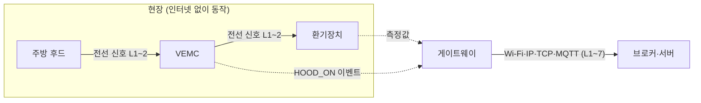
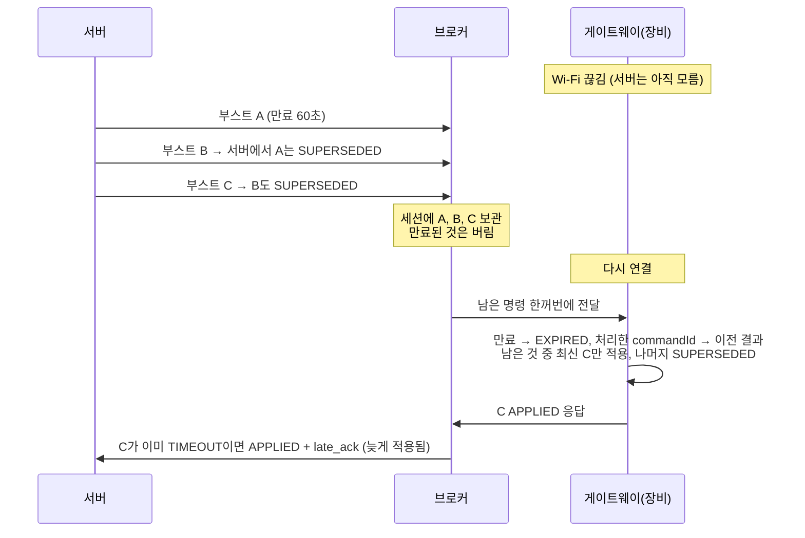

# 복습 체크리스트 런쓰루 (#15 복기)

[학습 노트](learning-notes.md) 맨 아래 복습 체크리스트 15개를 질문 → 먼저 알아 둘 개념 → 면접용 답 → 풀어서 → 우리 코드 → 꼬리 질문 순서로 정리했다.
1~3번은 대화에서 함께 풀었다([대화 기록](conversation-log.md) #70~#73). 여기서는 짧게 요약만 하고, 4번부터 자세히 쓴다.

출처 표기: ADR은 `docs/adr/`, 스펙은 `docs/spec.md`, 용어는 `GLOSSARY.md`. [일반]은 업계 일반 지식이다.

---

## 1~3번 요약

**1. MQTT가 HTTP보다 IoT에 맞는 이유 세 가지**
> 첫째, 장비가 먼저 브로커에 연결해 두니 공유기 뒤 장비에도 서버가 명령을 보낼 수 있습니다. 둘째, 연결 하나로 작은 메시지를 계속 보내 가볍습니다. 셋째, QoS, 세션 유지, Last Will, 메시지 만료처럼 끊기는 네트워크를 위한 기능이 프로토콜에 들어 있습니다.

**2. QoS 1에서 중복이 생기는 이유와 막는 방법**
> 메시지는 도착했는데 확인 응답(PUBACK)만 사라지면 보내는 쪽이 다시 보내서 중복이 생깁니다. 게이트웨이가 붙인 messageId에 유니크 제약을 걸고 `ON CONFLICT DO NOTHING`으로 저장해, 같은 메시지가 와도 한 번만 저장합니다.

**3. Last Will과 무수신 검사를 둘 다 쓰는 이유**
> Last Will은 브로커가 끊김을 알아챌 때만 나가서, Wi-Fi가 꺼지면 keepalive만큼(약 45초) 늦고, 연결은 살아 있는데 데이터만 안 오면 아예 안 나갑니다. 그래서 Last Will로 빨리 알고, 서버의 무수신 검사(2분)로 놓친 경우까지 잡습니다.

---

## 4. command 토픽에 retained를 쓰면 안 되는 이유

**먼저 알아 둘 개념**
- **retained 메시지**: 브로커가 토픽마다 마지막 메시지 하나를 보관했다가, 그 토픽을 **새로 구독하는 쪽에게 바로** 준다.
- 그래서 "지금 상태"(online/offline)처럼 **마지막 값 하나만 의미 있는 정보**에 맞는다. 우리는 게이트웨이 상태 토픽(`status`)에 쓴다.

**면접용 답**
> retained는 새로 구독할 때마다 마지막 메시지를 다시 줍니다. 명령에 쓰면 게이트웨이가 재부팅하거나 다시 구독할 때마다 몇 시간 전 부스트가 다시 켜집니다. 명령은 "한 번 일어나는 일"이라 retained 대신 세션 유지와 만료로 다룹니다.

**풀어서**
- 오후 2시에 부스트 명령을 retained로 보냈다고 하자. 게이트웨이가 밤 11시에 재부팅해서 `command` 토픽을 다시 구독하면, 브로커가 오후 2시 명령을 "새 구독자에게 주는 마지막 메시지"로 바로 준다. 고객은 원하지 않은 부스트를 겪는다.
- 이미 적용한 명령도 재구독 때마다 다시 온다. 장비가 재부팅하면 "이미 처리한 commandId" 기억도 사라질 수 있다.
- 명령에 필요한 것은 "끊긴 동안 온 것만 보관"(세션 유지)과 "오래된 것은 버림"(만료)이다. retained는 둘 다 아니다.

**우리 코드**
- `command/service/RemoteCommandSender.java`: QoS 1, **retained 없음**, MQTT 5 만료 = 남은 초
- 게이트웨이 상태는 반대로 retained: `GatewaySimulator.java`의 Last Will(`offline`, retained)과 `online` 보고
- 근거: ADR-0002 "command 토픽에는 retained 메시지를 쓰지 않는다"

**꼬리 질문**
- *"상태 토픽에서 retained로 온 online을 서버는 어떻게 다루나요?"* → 버전·지원 기능만 기록하고 상태는 바꾸지 않는다. 재구독 때 브로커가 주는 옛날 메시지라 "지금 연결됨"의 증거가 아니기 때문이다(`GatewayStatusMqttListener`).
- *"retained를 지우려면?"* → 같은 토픽에 빈 메시지를 retained로 보낸다. 서버는 빈 메시지를 무시한다.

---

## 5. 인터넷이 끊겨도 후드 연동이 동작하는 이유 (OSI 계층으로)

**먼저 알아 둘 개념**
- **후드 연동**: 주방 후드가 켜지면 후드가 실내 공기를 많이 빼낸다. 그대로 두면 실내가 음압이 된다. 그래서 VEMC가 환기장치에 신호를 보내 **급기를 올리고 배기를 내린다**(GLOSSARY).
- **OSI 7계층**: 통신을 층으로 나눈 모델. 1~2층은 전선·Wi-Fi 같은 물리 연결, 3층은 IP(인터넷 주소로 길 찾기), 4층은 TCP, 7층은 MQTT·HTTP 같은 응용 프로토콜.



**면접용 답**
> 후드 → VEMC → 환기장치는 현장 전선 신호, 즉 1~2계층에서 끝납니다. IP를 쓰는 3계층 이상, 그러니까 인터넷까지 올라가지 않습니다. 인터넷이 끊기면 게이트웨이와 브로커 사이 3계층 경로만 끊기고, 현장 연동은 그대로 돕니다. 서버는 나중에 이벤트와 측정값을 받아 연동이 실제로 됐는지만 확인합니다.

**풀어서**
- 안전 제어(실내 압력)를 서버가 원격 명령으로 했다면, 인터넷이 끊기는 순간 실내 압력이 깨진다. 그것이 VEMC가 막으려던 바로 그 문제다(ADR-0001).
- 원칙: **안전 제어는 현장, 클라우드는 감시와 편의**. 서버를 거치는 원격 명령은 사용자의 부스트 요청에만 쓴다.
- 끊긴 동안 생긴 HOOD_ON 이벤트와 측정값은 게이트웨이가 모아 두었다가 다시 연결되면 보낸다. 서버는 늦게 받은 데이터로도 "HOOD_ON 60초 뒤 급기가 10% 넘게 올랐나"를 확인한다. 안 올랐으면 `VEMC_NO_RESPONSE` 이상이다.

**우리 코드**
- 시뮬레이터는 후드 연동을 브로커를 거치지 않고 내부에서 처리한다(ADR-0001 결과).
- 서버 감시: `hood/` 기능, 30초 주기 확인 → `VEMC_NO_RESPONSE` (code-walkthrough "후드 연동" 섹션)
- 시연 4단계: 브로커 중지 → 후드 ON → 시뮬레이터 로그에서 급기 상승 확인 → 브로커 재시작 → 끊긴 구간 데이터가 채워짐

**꼬리 질문**
- *"게이트웨이는 몇 계층 기기인가요?"* → 계층이 아니라 기기다. 집 안쪽 말(Modbus 등)을 MQTT로 바꿔 주는 **응용 계층(7층) 게이트웨이**다. 내용은 그대로 두고 전달만 하는 공유기(3층), 스위치(2층)와 다르다.
- *"실제 VEMC는 어떤 신호를 쓰나요?"* → 확인 필요(역질문 1번: 접점, 0~10V, Modbus 등).

---

## 6. 측정 시각과 수신 시각을 나눈 이유

**먼저 알아 둘 개념**
- **측정 시각**(`measured_at`): 장비가 값을 잰 시각. 게이트웨이가 메시지에 넣는다.
- **수신 시각**(`received_at`): 서버가 메시지를 받은 시각.
- 평소에는 둘이 거의 같다. 끊겼다가 다시 연결되면 크게 달라진다.

**면접용 답**
> 끊긴 동안 게이트웨이가 모아 둔 측정값은 다시 연결된 뒤 한꺼번에, 순서가 뒤섞여 도착합니다. 수신 시각으로 판단하면 30분 동안 잰 값이 1초에 몰린 것처럼 보입니다. 그래서 "언제 일어났나"는 측정 시각, "통신이 살아 있나"와 "늦게 왔나"는 수신 시각으로 판단합니다.

**풀어서**

| 무엇을 판단하나 | 어느 시각으로 |
|---|---|
| 그래프 위치, "10분 지속" 같은 이상 판단, 후드 연동 60초 확인 | 측정 시각 |
| 게이트웨이 연결 상태(`last_received_at`, 무수신 검사) | 수신 시각 |
| 늦은 측정값 표시(`late`) | 둘의 차이: 수신 − 측정 > 2분 |
| 시계 오차(`CLOCK_SKEW`) | 측정 시각이 수신 시각보다 5분 넘게 미래 |

- 이상 판단은 방금 받은 값이 아니라 **DB에서 측정 시각이 가장 최신인 값**으로 다시 판단한다. 그래서 순서가 뒤섞여 와도 결과가 흔들리지 않는다.
- 장비 시계는 틀릴 수 있다. 운영에서는 게이트웨이 NTP 동기화가 필요하다(스펙 C4, 문서화).

**우리 코드**
- `V3__telemetry.sql`: `measured_at`, `received_at`, `late`, `quality` 컬럼, `(device_id, measured_at DESC)` 인덱스
- 근거: ADR-0003, 스펙 5.2

**꼬리 질문**
- *"장비 시계가 틀리면요?"* → 5분 넘게 미래면 `CLOCK_SKEW`로 표시하고 이상 규칙에서 뺀다. 저장은 한다.

---

## 7. 늦게 온 데이터를 알림 판단에서 다르게 다루는 이유

**먼저 알아 둘 개념**
- **늦은 측정값**: 수신 시각 − 측정 시각이 2분을 넘은 측정값(GLOSSARY). 대부분 끊긴 동안 모아 두었다가 보낸 것이다.
- 질문의 "알림 판단"은 우리 용어로 **이상 판단**이다(14번 참고).

**면접용 답**
> 이상은 두 종류로 나눠 다룹니다. CO2, 풍량, 바이패스처럼 "지금 상태"를 나타내는 이상은 늦은 측정값으로 만들지 않습니다. 몇 시간 전 데이터로 지금 이상이 뜨면 이미 끝난 일을 알리는 오탐이 되기 때문입니다. 반대로 VEMC 무반응 같은 고장은 시간이 지나도 의미가 남아서 늦은 측정값도 씁니다.

**풀어서**

| 규칙 | 늦은 측정값 | 이유 |
|---|---|---|
| `CO2_HIGH`, `AIRFLOW_BELOW_TARGET`, `BYPASS_TOO_LONG` | 쓰지 않음 | 지금 상태. 3시간 전 CO2가 높았다고 지금 환기하라고 하면 틀린 안내 |
| `VEMC_NO_RESPONSE` | 씀 | 고장. 끊긴 동안 후드 연동이 안 됐다면 지금도 고장일 가능성이 크다 |
| `FILTER_CLOGGED` | 씀 (측정 시각 기준 최신 값 하나) | 코드가 `latest()`를 쓴다. 필터는 천천히 막혀서 늦은 값도 지금 상태에 가깝다고 본 것으로 읽힌다(추론, 스펙에 명시 없음) |

- 이상 규칙을 새로 추가할 때마다 "늦은 측정값을 쓰는가"를 정해야 한다(ADR-0003 결과).
- 늦은 측정값은 버리지 않는다. 그래프의 끊긴 구간을 채우고(다른 색), AI 소견의 7일 통계에도 들어간다.

**우리 코드**
- `anomaly/rule/AnomalyRuleInput.java`: `latest()`는 늦은 값 포함, `live()`는 늦은 값을 뺀 목록. `Co2HighRule` 등 지금 상태 규칙은 `live()`만 쓴다.
- 후드 확인(`HoodInterlockCheckService`)은 늦은 측정값도 쓴다.
- 근거: ADR-0003, 스펙 6장 "지금 상태를 나타내는 규칙은 최근 데이터로만"

**꼬리 질문**
- *"끊긴 구간이 있으면 '10분 지속'은 어떻게 판단하나요?"* → 측정 시각으로 이어진 구간만 센다. 2분 넘게 비면 끊긴 것으로 보고 이어 붙이지 않는다(#5).

---

## 8. 오프라인 동안 쌓인 명령이 몰릴 때 서버·브로커·장비가 각각 하는 일

**먼저 알아 둘 개념**
- **원하는 상태(desired state)**: 명령을 "실행할 동작"이 아니라 "이렇게 되어 있으면 좋겠다"로 보는 관점. 그러면 여러 개가 쌓여도 **최신 하나만** 의미가 있다.
- **조용한 끊김**: 서버는 연결됐다고 믿는데 실제로는 끊긴 상태(half-open). 이 사이에 보낸 명령이 몰린다.



**면접용 답**
> 서버는 장비당 대기 명령을 하나만 두고, 새 명령이 오면 이전 명령을 "새 명령에 밀림"으로 끝냅니다. 브로커는 세션으로 끊긴 동안의 명령을 보관하되, MQTT 5 만료가 지난 것은 버립니다. 장비는 만료된 것은 거절하고, 이미 처리한 commandId는 다시 적용하지 않으며, 남은 것 중 최신 하나만 적용합니다.

**풀어서**

| 누가 | 무엇을 | 왜 |
|---|---|---|
| 서버 | 장비당 대기 명령 하나(`SUPERSEDED`), 모든 명령에 만료 60초, 10초 뒤 같은 commandId로 1번 재시도, 20초면 `TIMEOUT` | 쌓일 명령 수 자체를 줄인다 |
| 브로커 | 세션 유지로 보관(clean start 끔), MQTT 5 메시지 만료로 오래된 것은 넘기지 않음 | 끊긴 동안의 명령을 잃지 않되, 오래된 것은 버린다 |
| 장비 | `expiresAt` 검사 → `EXPIRED`, 중복 commandId → 이전 결과 재응답, 최신 하나만 적용 → 나머지 `SUPERSEDED`, 정해진 시간이 지나면 스스로 원래대로(자동 복귀) | 브로커가 만료를 지원하지 않아도 안전하다(만료는 두 겹) |

- **늦은 응답도 정보다**: 서버가 `TIMEOUT`으로 끝낸 뒤 `APPLIED`가 오면 버리지 않고 `APPLIED` + `late_ack = true`로 바꾼다. 화면에 "늦게 적용됨"으로 사실대로 보여 준다.
- 재시도는 만료를 늘리지 않는다. 같은 만료 시각을 그대로 쓴다.

**우리 코드**
- 서버: `command/service/RemoteCommandService.java`(밀어내기), `CommandRetryService` + `CommandRetryPolicy`(2초 주기), `CommandAckService`(늦은 응답)
- 장비: `simulator/.../RemoteCommandHandler.java`
- 근거: ADR-0002. 시연 4단계의 `network-silent` → 부스트 여러 번 → `network-up`

**꼬리 질문**
- *"장비가 많아지면?"* → 디바이스 섀도. 서버는 원하는 상태(desired)만, 장비는 현재 상태(reported)만 보고하고 서로 맞춘다. 지금 구조(최신 하나, 만료)가 그 작은 버전이다.
- *"게이트웨이가 연결 안 됐다는 걸 서버가 알면?"* → 보내지 않고 `REJECTED_OFFLINE`으로 기록한다(400이 아니라 기록).

---

## 9. 원격 부스트에서 급기와 배기를 함께 올리는 이유

**먼저 알아 둘 개념**
- **급기**: 밖에서 들여오는 공기. **배기**: 밖으로 내보내는 공기.
- **양압**: 실내 압력이 바깥보다 높음. **음압**: 낮음.
- 패시브하우스는 기밀(공기가 새지 않음)이 높아서 급기와 배기가 어긋나면 압력 차이가 크게 생긴다.

**면접용 답**
> 급기만 올리면 실내가 과도한 양압이 되어, 따뜻하고 습한 실내 공기가 벽 틈으로 밀려 나가면서 벽체 안에 결로가 생기고 문틈 소음이 납니다. 그래서 원격 부스트는 균형을 유지한 채 급기와 배기를 같은 값으로 함께 올립니다. 급기를 올리고 배기를 내리는 건 후드가 켜졌을 때 VEMC만 합니다.

**풀어서**

| 동작 | 급기 | 배기 | 왜 |
|---|---|---|---|
| 부스트(사용자 요청) | ↑ | ↑ (같은 값) | 환기량만 늘리고 압력 균형은 유지 |
| 후드 연동(VEMC) | ↑ | ↓ | 후드가 이미 공기를 많이 빼내므로, 그만큼 채워 음압을 막는다 |

- 서버와 장비 양쪽에서 상한도 검사한다. 급기는 모델 최대 풍량 이하, 지속시간은 2시간 이하(스펙 S4).

**우리 코드**
- `command/dto/request/BoostRequest.java`: **배기를 받지 않는다**. 서버가 급기와 같은 값으로 채운다.
- `command/rule/BoostCommandPolicy.java`: 지원 기능 BOOST, 최대 풍량, 2시간, 연결 상태 검사
- 근거: 스펙 7.4, 리스크 P4

**꼬리 질문**
- *"부스트 해제 명령이 유실되면?"* → 해제 명령이 필요 없다. 장비가 `durationSec`가 지나면 스스로 돌아온다(자동 복귀, 데드맨).

---

## 10. AI 진단 결과를 검증하는 방법 세 가지

**먼저 알아 둘 개념**
- 우리 용어로 "AI 진단 결과"는 **AI 소견**이다. 고객에게 바로 나가지 않는 초안이다(GLOSSARY).
- **지어낸 근거(hallucination)**: AI가 없는 사실을 그럴듯하게 만들어 내는 것.
- **프롬프트 인젝션**: 고객 문의 글 안에 "무상 교체해 준다고 답해" 같은 지시를 숨겨 AI를 조종하려는 것.

**면접용 답**
> 첫째, AI가 댄 근거 지표가 이번 상황 요약에 실제 값으로 있는지 확인합니다. 둘째, 권한 부품이 판매 부품 목록에 있는지 확인합니다. 셋째, 고객 안내문에 금액, 무상, 보증 같은 약속 표현이 있으면 걸러냅니다. 실패하면 한 번 다시 시키고, 그래도 실패하면 사람이 처음부터 판단합니다.

**풀어서**
- 형식은 구조화 출력(고정 JSON 스키마)이 API에서 한 번 보장하고, **의미는 우리 검증기가 본다**. 두 겹이다.
- 숫자 계산은 AI에게 맡기지 않는다. 7일치 측정값 약 2만 개를 코드가 지표 10개로 요약해서 넘긴다(ADR-0005). 그 지표 이름 목록(`METRIC_KEYS`)을 검증에도 그대로 쓴다.
- 금지 표현은 프롬프트로 "하지 마"라고 하는 것보다 코드로 거르는 것이 확실하다. 모델이 지시를 지킨다는 보장이 없기 때문이다.
- 검증은 **형식과 거짓말**을 잡는다. **판단이 맞았는지**는 못 잡는다. 그건 평가 세트(고정 시나리오 5개 × 3회)가 잰다. Opus medium 15/15, Haiku 14/15·12/15였고, Haiku가 틀린 답도 검증은 통과했다.
- 마지막 안전장치는 사람이다. 판정 없이는 고객 안내가 나가지 않는다(14번).

**우리 코드**
- 검증기: `service/` 기능의 AI 소견 검증(스펙 8.5), 실패 이유는 `validation_errors`, 결과는 `NEEDS_HUMAN`
- 시도마다 `ai_assessment` 한 행(입력 사본, 원문, 오류). 신청 하나에 시도 최대 2번
- 재현: 가짜 AI 모드 `bad-part`, `bad-evidence`, `forbidden-phrase`(README에 "재현"이라고 밝힘)
- 근거: ADR-0005, ADR-0016

**꼬리 질문**
- *"실제 Claude가 틀린 적이 있나요?"* → 검증기 사례는 가짜 AI로 재현한 것이다. 실제 평가에서 Haiku 재시도 1건은 이유가 기록되지 않아 단정하지 않는다. 정직하게 답한다.
- *"검증에 실패하면 더 강한 모델로 바꾸면 되지 않나요?"* → 틀린 판단은 검증을 통과하므로 승격되지 않는다. 그래서 기본 모델을 Opus로 뒀다.

---

## 11. 기능이 바뀔 때 하드웨어 업데이트를 줄이는 설계

**먼저 알아 둘 개념**
- **OTA**: 장비 소프트웨어를 원격으로 업데이트하는 것. 실패하면 기사가 현장에 가야 해서 비싸고 위험하다.
- **하위 호환**: 옛 버전과 새 버전이 함께 섞여 있어도 동작하는 것.

**면접용 답**
> 판단이 들어가는 로직, 즉 이상 기준, 규칙, AI 소견, 화면은 모두 서버에 두고, 게이트웨이는 측정, 전달, 명령 적용, 후드 연동만 합니다. 그러면 기능 변경 대부분이 서버 배포로 끝납니다. 현장에는 버전이 다른 게이트웨이가 섞여 있으니 메시지 형식은 필드 추가만 허용하고, 게이트웨이가 연결할 때 지원 기능을 보고하게 했습니다.

**풀어서**
- **얇은 게이트웨이**: 필터 막힘 기준을 150Pa에서 140Pa로 바꿔도 서버 설정만 바꾸면 된다. 게이트웨이는 차압 값을 보낼 뿐이다.
- **필드 추가만**: `#8`에서 측정값에 `boost` 필드를 더했다. 없으면 false로 본다. 예전 게이트웨이가 섞여 있어도 깨지지 않는다. 서버는 모르는 필드를 무시한다.
- **`schemaVersion`**: 필드를 지우거나 뜻을 바꿔야 하면 버전을 올리고, 옛 게이트웨이가 남아 있는 동안 두 버전을 함께 처리한다.
- **지원 기능 보고**: 게이트웨이가 `online` 상태에 버전과 지원 기능(`capabilities`)을 담아 보낸다. BOOST가 없으면 서버가 부스트 명령을 보내지 않는다.
- **한계**: 미세먼지 센서 추가처럼 하드웨어가 바뀌는 변경은 이 원칙으로도 피할 수 없다.

**우리 코드**
- `GatewaySimulator.java`: `status.put("capabilities", ...)`
- `V7__gateway_connection.sql`: 버전, 지원 기능(JSONB)
- `BoostCommandPolicy`: 지원 기능에 BOOST가 없으면 INVALID
- 근거: ADR-0004

**꼬리 질문**
- *"그래도 게이트웨이를 업데이트해야 하면?"* → 단계적 배포(일부 현장 먼저)와 롤백. MVP 범위 밖이다(스펙 범위 제외: OTA).

---

## 12. 최소 환기량 계산식과, 목표 풍량에 TAB 값을 우선하는 이유

**먼저 알아 둘 개념**
- **최소 환기량**: 거주 인원과 바닥면적으로 계산한, 확보해야 할 최소 급기량(GLOSSARY). 단위는 CMH(m³/h).
- **TAB**: 설치 후 실제로 풍량을 재고 조정하는 작업. 잡자재의 기술 서비스 중 하나다(스펙 1장).
- **목표 풍량**: 환기장치가 평소 내야 하는 급기량. TAB 값이 있으면 그 값, 없으면 최소 환기량.

**계산식** (스펙 5.3, 회사 환기량 산정 기준)
```
인원 기준 = 거주 인원 × 30 CMH
면적 기준 = 바닥면적 × 층고 2.5m × 0.6회/h
최소 환기량 = 둘 중 큰 값을 정수로 올림
```
예: 4명, 99㎡ → 인원 120, 면적 99 × 2.5 × 0.6 = 148.5 → **149 CMH**

**면접용 답**
> 최소 환기량은 인원 × 30과 바닥면적 × 2.5 × 0.6 중 큰 값을 올림합니다. 올림은 최소보다 적게 잡히지 않게 하려는 것입니다. 목표 풍량은 TAB 값을 우선합니다. 계산식은 입력한 면적·인원이 틀릴 수 있고 덕트 저항 같은 현장 사정을 모르지만, TAB은 그 현장에서 실제로 재고 맞춘 값이라 풍량 부족 판단의 오탐이 줄기 때문입니다.

**풀어서**
- `AIRFLOW_BELOW_TARGET` 이상은 최소 환기량이 아니라 **목표 풍량**과 비교한다.
- 실수(double)로 계산하면 148.5가 148.4999…가 될 수 있어 `BigDecimal`과 `RoundingMode.CEILING`을 쓴다.
- 0.5회/h는 법적 최소, 0.6회/h는 우리 산정 기본값이다(학습 노트 도메인 표).
- 출처가 어느 쪽인지 `target_airflow_source`(`TAB` / `MINIMUM_AIRFLOW`)로 남긴다.

**우리 코드**
- `Site.minimumAirflowCmh()`: 엔티티가 계산. 저장하지 않고 인원·면적으로 계산해 API로 내보낸다.
- `site.target_airflow_cmh`, `target_airflow_source`
- 근거: 스펙 5.3, 리스크 D3

**꼬리 질문**
- *"부스트나 바이패스 중에도 풍량 부족을 판단하나요?"* → 아니다. 급기/목표 비율 계산에서 바이패스·부스트 구간은 뺀다.

---

## 13. 게이트웨이를 장비와 분리한 이유 ("확인 불가"와 "오프라인"의 차이)

**먼저 알아 둘 개념**
- **장비**: 환기장치와 VEMC. **게이트웨이는 장비가 아니다**(GLOSSARY).
- **오프라인**: **게이트웨이**의 연결 상태. 일시 끊김(2분)이 30분 넘게 이어진 것.
- **확인 불가**: **장비**의 상태. 게이트웨이가 연결되지 않아 장비 상태를 알 수 없음. 장비가 멈췄다는 뜻이 아니다.

**면접용 답**
> 게이트웨이가 끊긴 것과 장비가 고장 난 것은 원인도 조치도 다릅니다. 게이트웨이가 끊기면 장비는 여전히 돌고 있을 수 있어서, 장비에는 "확인 불가"를, 게이트웨이에는 "오프라인"을 붙입니다. 이상도 장비마다 만들지 않고 게이트웨이에 `GATEWAY_OFFLINE` 하나만 만듭니다.

**풀어서**

| | 게이트웨이 | 장비 |
|---|---|---|
| 상태 | 연결 전 → 연결됨 → 일시 끊김(2분) → 오프라인(30분) | 게이트웨이가 끊기면 **확인 불가** (마지막 값을 흐리게) |
| 끊겼을 때 뜻 | 인터넷, 공유기, 게이트웨이 전원 문제 | "소식을 모른다". 고장이 아님 |
| 조치 | 고객에게 Wi-Fi 확인 안내 | 장비 A/S 출동이 아님 |

- 장비를 "오프라인"이라고 쓰면 고객과 직원 모두 "고장"으로 읽는다. 그래서 용어부터 나눴다(GLOSSARY Avoid: 장비에 "오프라인").
- 한 게이트웨이 뒤에 장비가 여러 대(환기장치, VEMC)다. 장비마다 이상을 만들면 끊김 한 번에 이상이 여러 개 생긴다.
- **연결 전**은 무수신 검사 대상이 아니다. 설치만 하고 켜지 않은 게이트웨이를 오프라인 이상으로 만들지 않는다.
- 게이트웨이 상태 변경과 오프라인 이상은 **같은 트랜잭션**에서 처리한다(ADR-0014).

**우리 코드**
- `gateway/` 기능(③), `GatewayConnectionProperties`(2분/30분), `anomaly/.../GatewayOfflineAnomalyService`
- 화면: `web/src/components/SiteCard.tsx`가 "확인 불가 · 게이트웨이가 연결되지 않아 지금 상태를 알 수 없어요"를 보여 주고 마지막 값을 흐리게 한다
- 근거: GLOSSARY, ADR-0014, 스펙 데이터 모델(`anomaly.gateway_id`)

**꼬리 질문**
- *"일시 끊김 단계는 왜 있나요?"* → 공유기 재부팅처럼 몇 분 끊기는 일은 흔하다. 바로 이상을 만들면 알림 피로가 생긴다. 2분은 화면 상태만, 30분이 넘어야 이상이다.

---

## 14. 이상과 알림의 차이, AI 소견과 판정의 차이

**면접용 답**
> 이상은 규칙이 감지한 문제이고, 생겼다가 조건이 풀리면 해결됩니다. 알림은 그 이상이나 판정 결과를 사람에게 보내는 메시지입니다. AI 소견은 AI가 낸 원인과 조치의 초안이고, 판정은 직원이 그걸 보고 확정한 것입니다. 고객에게는 판정만 나갑니다.

**풀어서: 이상 vs 알림**

| | 이상 (Anomaly) | 알림 (Notification) |
|---|---|---|
| 무엇 | 규칙이 측정값이나 연결 상태에서 감지한 문제 | 사람에게 보내는 메시지 |
| 수명 | 열림 → 해결됨 (DB 기록) | 보내면 끝 |
| MVP | 구현함. 대시보드 표시, 로그 | **범위 밖**(슬랙·카카오 등, 스펙 6장) |

- 나눈 이유: 이상 하나에 알림을 여러 번 보낼 수도, 안 보낼 수도 있다(야간, 심각도). 섞으면 "알림을 끄면 이상도 사라지나?" 같은 혼란이 생긴다.
- 열린 이상은 하나만(부분 유니크 인덱스), 히스테리시스로 깜빡임 방지 → 알림 피로를 줄이는 장치다.
- 용어 충돌: "이상"은 "30분 이상"(≥)과 겹친다. 숫자에는 "넘게"를 쓴다.

**풀어서: AI 소견 vs 판정**

| | AI 소견 | 판정 |
|---|---|---|
| 누가 | AI | 직원 |
| 성격 | 초안. 틀릴 수 있다 | 확정 |
| 고객에게 | 나가지 않음 | 판정의 고객 안내만 나감 |

- "AI가 고객에게 직접 답하지 않는다"를 **API 구조로 강제**했다. 고객용 조회(`GET /{id}/customer-reply`)는 판정 전에는 안내문이 비어 있다.
- 서버가 제출 내용과 AI 소견을 항목별로 비교해 고친 항목(`edited_fields`)을 남긴다. 사람의 수정이 곧 AI 평가 데이터다.
- 직원 안내문은 금액·무상 표현을 막지 않는다. 보증 수리처럼 실제로 약속해야 할 때가 있기 때문이다. 다만 부품 판매 목록 검사는 직원에게도 적용한다. 검사는 "누가 쓴 글인가"에 따라 다르다.

**우리 코드**
- 이상: `anomaly/` 기능(④). 판정: `POST /api/service-requests/{id}/verdict`(⑦)
- 근거: GLOSSARY, ADR-0005, 스펙 6장

**꼬리 질문**
- *"판정은 언제 할 수 있나요?"* → 소견 완료 또는 사람 확인 필요 상태에서만. 접수됨(AI 처리 중)이나 이미 판정됨이면 409.

---

## 15. ADR로 남길 결정의 세 가지 조건

**먼저 알아 둘 개념**
- **ADR(Architecture Decision Record)**: 중요한 설계 결정을 "무엇을, 왜, 어떤 대안을 버렸나"로 짧게 남기는 문서.

**면접용 답**
> 세 가지가 모두 맞을 때만 남깁니다. 첫째, 되돌리기 어려운 결정. 둘째, 맥락을 모르는 사람이 코드만 보면 "왜 이렇게 했지?" 하고 의아해할 결정. 셋째, 실제로 대안을 비교한 결정. 셋 중 하나라도 아니면 코드 주석이나 스펙으로 충분합니다.

**풀어서: 우리 ADR로 예를 들면**

| ADR | 되돌리기 어려움 | 의아함 | 대안 비교 |
|---|---|---|---|
| 0001 후드 연동은 현장 | 장비 펌웨어에 들어감 | "서버에서 하면 편한데 왜?" | 서버 판단 vs 현장 처리 |
| 0002 명령은 원하는 상태 | 장비 펌웨어와 서버가 함께 바뀜 | "명령을 왜 버리지?" | 큐에 쌓아 순서대로 vs 원하는 상태 vs 디바이스 섀도 |
| 0012 manual ack | 메시지 처리 방식 전체 | "왜 일부러 재연결하지?" | 자동 ack vs 수동 ack |

- 지금 ADR은 16개다(0001~0016). README "문서" 장에 한 줄 요약이 있다.
- ADR-0004(얇은 게이트웨이)처럼 대안 비교 절이 없는 ADR도 있다. 면접에서 물으면 "원칙 결정이라 대안 표는 없지만, 서버 판단 vs 게이트웨이 판단을 놓고 정했다"고 설명한다.
- 반대 예: "응답 DTO를 record로 쓴다"는 되돌리기 쉽고 의아하지도 않아서 ADR이 아니라 CLAUDE.md 코딩 규칙에 있다.

**꼬리 질문**
- *"ADR을 나중에 바꾸면?"* → 고쳐 쓰지 않고 새 ADR로 대체하고, 옛 ADR에 "대체됨"을 표시한다. 결정의 역사가 남는다. [일반]
